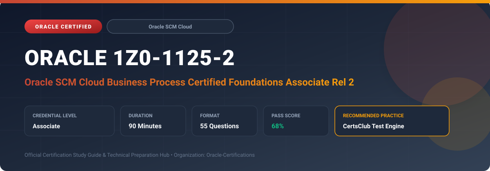

  

# Oracle 1Z0-1125-2: Oracle SCM Cloud Business Process Certified Foundations Associate Rel 2

---

## 1. Exam Overview & Candidate Profile

The **Oracle 1Z0-1125-2: Oracle SCM Cloud Business Process Certified Foundations Associate Rel 2** credential validates foundational knowledge of modern supply chain management and core business processes within Oracle Fusion Cloud SCM.

Candidates prove their understanding of Source to Settle, Order to Cash, Plan to Produce, Inventory and Logistics Operations, Quality Management, and Maintenance processes across enterprise supply chains.

### Target Audience & Prerequisites
- **Target Roles**: Implementation Specialists, Cloud Architects, Technical Leads, Enterprise Consultants, and Systems Engineers.
- **Recommended Experience**: 1–2 years of practical, hands-on experience designing, implementing, and maintaining corresponding Oracle solutions.
- **Credential Earned**: Associate Certification.

---

## 2. Key Exam Specifications

| Specification | Details |
| :--- | :--- |
| **Exam Code** | **Oracle 1Z0-1125-2** |
| **Official Title** | Oracle SCM Cloud Business Process Certified Foundations Associate Rel 2 |
| **Certification Track** | Oracle SCM Cloud |
| **Exam Duration** | 90 Minutes |
| **Number of Questions** | 55 Questions |
| **Passing Score** | 68% |
| **Question Format** | Multiple Choice (Single/Multiple Answer), Scenario-Based Questions |
| **Delivery Provider** | Oracle University / Pearson VUE (Online Proctored or Test Center) |
| **Recommended Practice Engine** | [CertsClub Oracle Practice Tests](https://www.certsclub.com/oracle/1z0-1125-2-dumps.html) |

---

## 3. Official Blueprint & Exam Domain Breakdown

The examination assesses candidate competencies across core functional domains weighted as follows:

| Domain Area | Weighting |
| :--- | :--- |
| **Source-to-Settle & Procurement Lifecycle** | `25%` |
| **Order-to-Cash & Fulfillment Operations** | `25%` |
| **Plan-to-Produce & Manufacturing Processes** | `20%` |
| **Inventory Management & Logistics Flows** | `15%` |
| **Maintenance, Quality & Analytics Governance** | `15%` |

---

## 4. Deep Dive into Complex & Challenging Technical Topics

To secure a passing score on the 1Z0-1125-2 exam, candidates must master the following advanced concepts:

- Source-to-Settle flow: purchase requisitions, supplier qualification, purchase orders, receiving, and invoice matching.
- Order-to-Cash flow: sales order entry, pricing, Global Order Promising (GOP), shipping, and billing.
- Plan-to-Produce flow: demand forecasting, constrained planning, work order execution, and cost accounting.
- Inventory logistics: subinventory transfers, intercompany transfers, pick/pack/ship staging, and cycle counts.
- Quality inspection plans, nonconformance disposition, and preventive asset maintenance integration.

---

## 5. Scenario-Based Demo & Practice Questions

### Question 1
In the standard Plan to Produce business process, what document triggers the allocation and staging of component materials for shop floor execution?

A) Released Manufacturing Work Order
B) Approved Purchase Requisition
C) Sales Order Booking
D) Inventory Cycle Count Request

- **Correct Answer**: `A) Released Manufacturing Work Order`  
- **Technical Explanation**: Releasing a manufacturing work order authorizes production on the shop floor and initiates material allocation and reservation in Oracle Inventory Management.

---

### Question 2
Which component in Oracle SCM Cloud evaluates supply availability across all distribution centers and manufacturing plants to determine realistic customer delivery commitments?

A) Global Order Promising (GOP)
B) Cost Accounting Engine
C) Supplier Qualification Manager
D) Work Definition Builder

- **Correct Answer**: `A) Global Order Promising (GOP)`  
- **Technical Explanation**: Global Order Promising (GOP) performs real-time capable-to-promise (CTP) and available-to-promise (ATP) calculations to commit accurate shipment and delivery dates.

---

## 6. Recommended Preparation Strategy & Practice Testing Engine

Achieving certification in **Oracle 1Z0-1125-2** requires balanced theoretical study and scenario-based simulation practice:

1. **Review Oracle Documentation**: Master architecture guides, implementation workbooks, and administration manuals on the Oracle Help Center.
2. **Hands-on Lab Practice**: Execute real-world configuration, policy setup, and troubleshooting tasks in your cloud tenancy or test instance.
3. **Simulated Exam Drills**: Practice answering timed, scenario-based multiple-choice questions to familiarize yourself with the question formats, traps, and timing constraints.

### Practice With CertsClub
For realistic practice questions, updated dumps, and mock testing environments:
- **Resource**: [CertsClub Oracle Practice Test Engine](https://www.certsclub.com/oracle/1z0-1125-2-dumps.html)
- **Special Discount**: Use coupon code **`club20`** during checkout for an instant **20% discount** on all practice exam bundles and testing engines.

---

## 7. Official Documentation & References

- [Oracle University Certification Registry](https://education.oracle.com/)
- [Oracle Help Center Documentation Portal](https://docs.oracle.com/)
- [Oracle Cloud Infrastructure & Applications Guides](https://docs.oracle.com/en/cloud/)
- [CertsClub Oracle Certification Exam Practice](https://www.certsclub.com/oracle/1z0-1125-2-dumps.html)

---

## 8. SEO & Discovery Keywords

`oracle 1z0-1125-2, oracle 1z0-1125-2 exam, oracle 1z0-1125-2 dumps, 1Z0-1125-2 practice questions, 1Z0-1125-2 study guide, oracle scm cloud business process certified foundations associate rel 2, certsclub 1z0-1125-2`